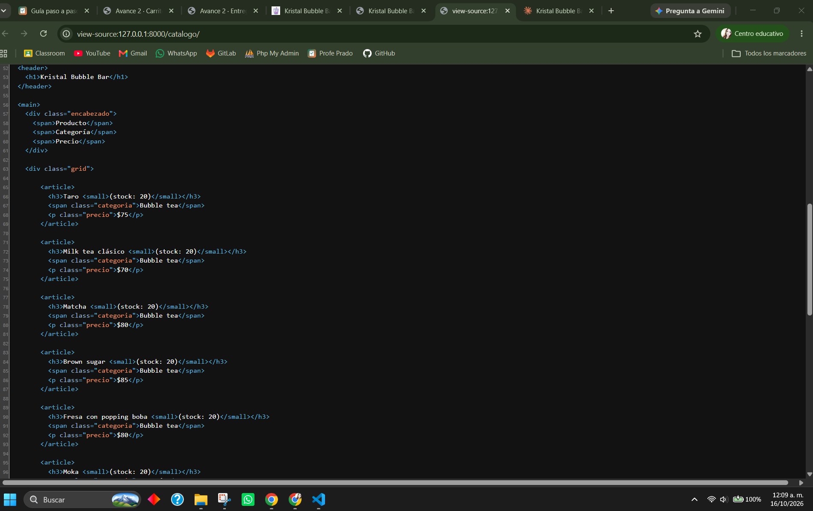
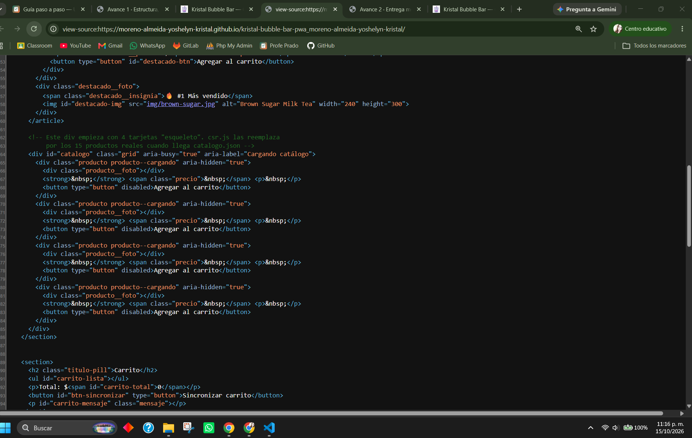
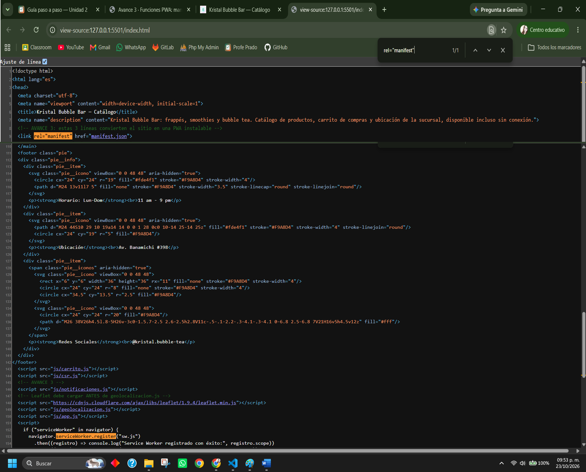
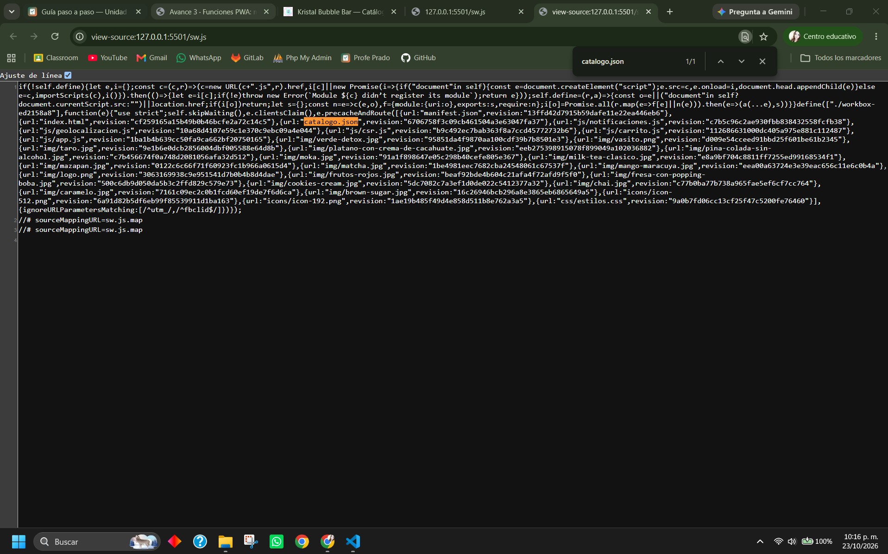
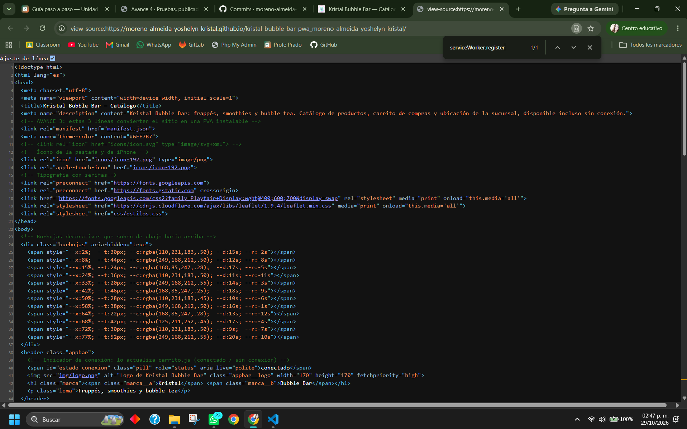
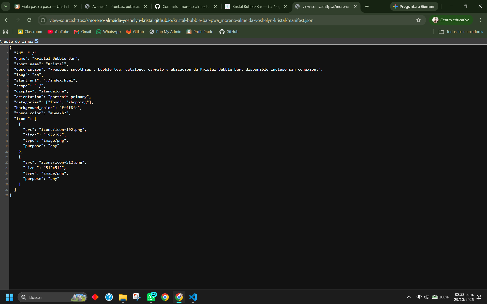
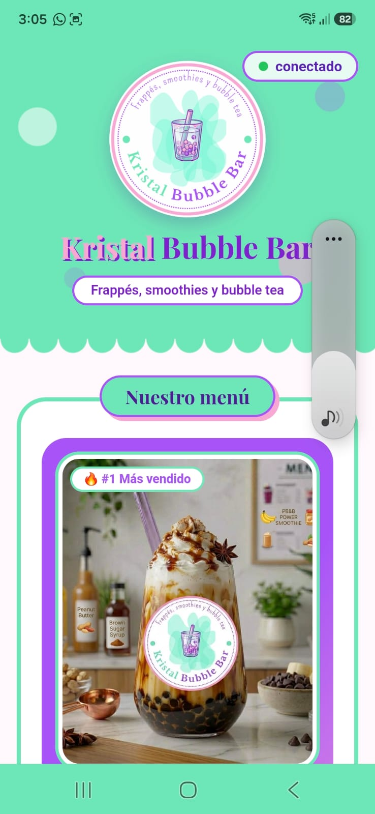

# 🧋 Kristal Bubble Bar

## 🪪 Identificación

| Campo | Datos |
|---|---|
| **Nombre completo** | Moreno Almeida Yoshelyn Kristal |
| **Grupo** | ING10-1 |
| **Negocio** | Kristal Bubble Bar |
| **Giro** | Barra de bebidas frías personalizables |
| **URL del repositorio** | https://github.com/moreno-almeida-yoshelyn-kristal/kristal-bubble-bar-pwa_moreno-almeida-yoshelyn-kristal |
| **URL de GitHub Pages** | https://moreno-almeida-yoshelyn-kristal.github.io/kristal-bubble-bar-pwa_moreno-almeida-yoshelyn-kristal/ |

## Historial de avances

| Avance | Hash del commit entregado | Fecha |
|---|---|---|
| 1 | f7b3e31 | 10/10/2026 |
| 2 | 71de7bd | 16/10/2026 |
| 3 | 40fb03c | 23/10/2026 |
| 4 | (se escribe en el reporte PDF) | (30/10/2026) |

## Comparación SSR vs CSR

### SSR (Django): los productos llegan escritos en el HTML

### CSR (JavaScript): el div del catálogo llega vacío

## Funciones PWA (avance 3)

### index.html: manifest y registro del Service Worker activos

### sw.js: Workbox precachea el catálogo y las fotos

## Versión publicada (avance 4)

### index.html en GitHub Pages

### manifest.json en GitHub Pages

### Mi app instalada en el celular

## Guía de instalación y uso

### 1. Abrir la aplicación

1. Abre **Google Chrome** desde tu computadora o celular.
2. Ingresa al siguiente enlace para entrar a la aplicación:
   https://moreno-almeida-yoshelyn-kristal.github.io/kristal-bubble-bar-pwa_moreno-almeida-yoshelyn-kristal/
3. Espera a que cargue el catálogo. En la parte superior derecha aparecerá un indicador que te mostrará si estás **conectado** a internet.

### 2. Instalar la aplicación

**En computadora (Chrome o Edge):**

1. Busca el ícono de **Instalar** al final de la barra de direcciones, a la izquierda de la estrella. Si no aparece, abre el menú de los tres puntos (⋮), selecciona **Enviar, guardar y compartir** y después **Instalar página como aplicación…**.
2. Haz clic en **Instalar** y espera a que termine el proceso.
3. Cuando termine, podrás abrir la aplicación en su propia ventana y encontrarla en tu escritorio o en la lista de aplicaciones.

**En Android (Chrome):**

1. Abre Chrome y entra al siguiente enlace:
   https://moreno-almeida-yoshelyn-kristal.github.io/kristal-bubble-bar-pwa_moreno-almeida-yoshelyn-kristal/
2. Toca los tres puntos (⋮) que aparecen en la esquina superior derecha.
3. Busca la opción **Instalar** o **Instalar y crear acceso directo** y selecciónala.
4. Presiona **Instalar** y espera a que termine.
5. Al finalizar, aparecerá el ícono de Kristal en tu pantalla de inicio y en el menú de aplicaciones.
6. Abre la aplicación desde su ícono. Se mostrará en pantalla completa, sin la barra de direcciones de Chrome.

**En iPhone (Safari):**

1. Abre Safari e ingresa al enlace de la aplicación.
2. Toca el botón **Compartir**.
3. Selecciona **Agregar a pantalla de inicio**.
4. Toca **Agregar** para que el ícono de Kristal Bubble Bar aparezca en tu pantalla de inicio.

### 3. Cómo utilizar la aplicación

1. **Ver el menú:** en la sección "Nuestro menú" puedes encontrar el producto estrella y las diferentes bebidas disponibles, como bubble tea, frappés y smoothies.
2. **Agregar productos al carrito:** selecciona la bebida que quieras y presiona **Agregar al carrito**. El producto aparecerá en tu carrito, donde podrás aumentar o disminuir la cantidad con los botones **+** y **−**, o eliminarlo con la opción **Quitar**.
3. **Sincronizar el carrito:** presiona **Sincronizar carrito** para enviar tu pedido. Si no tienes internet en ese momento, el pedido se guardará y se sincronizará automáticamente cuando vuelva la conexión.
4. **Activar las notificaciones:** presiona **Activar notificaciones** y acepta los permisos. Así podrás recibir avisos cuando agregues un pedido.
5. **Consultar la distancia a la sucursal:** en la sección "Distancia a la sucursal", presiona **Usar mi ubicación** y permite el acceso a tu ubicación. Se mostrará un mapa con la ruta, la distancia en kilómetros y el tiempo estimado para llegar a Kristal Bubble Bar, ubicada en Av. Banamichi #398.

### 4. Cómo utilizar la aplicación sin internet

1. Abre la aplicación al menos una vez mientras tengas conexión a internet para que se guarden los recursos necesarios.
2. Si te quedas sin internet, el indicador mostrará que estás **sin conexión**. Podrás seguir viendo el catálogo y utilizando el carrito.
3. El mapa y la ruta necesitan conexión a internet para funcionar. Los pedidos que queden pendientes se sincronizarán cuando vuelva la conexión.

### 5. Cómo desinstalar la aplicación

**En computadora:**

1. Abre la aplicación.
2. Entra al menú de los tres puntos (⋮) de la ventana.
3. Selecciona la opción **Desinstalar**.

**En Android:**

1. Mantén presionado el ícono de Kristal Bubble Bar.
2. Selecciona **Desinstalar** y confirma la acción si te lo solicita el dispositivo.
